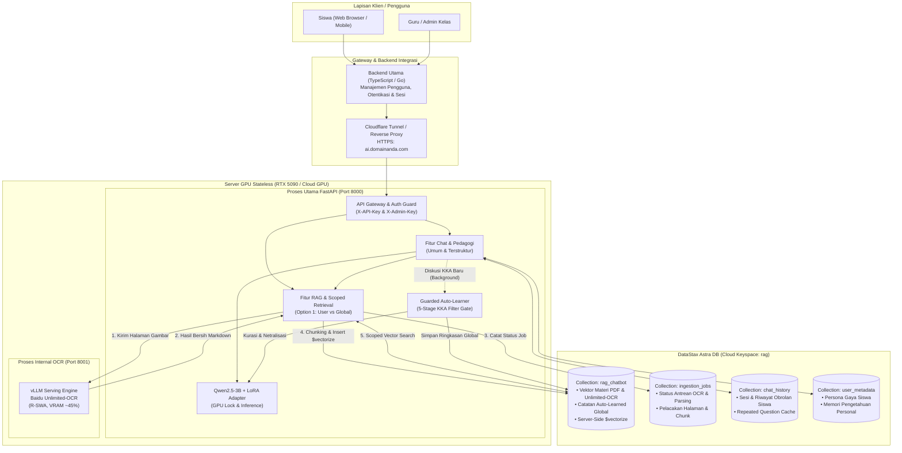
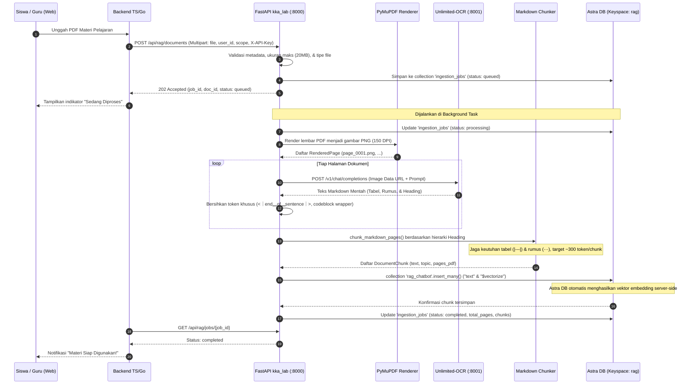
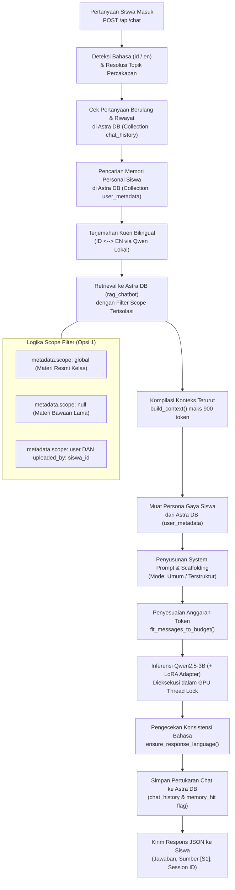
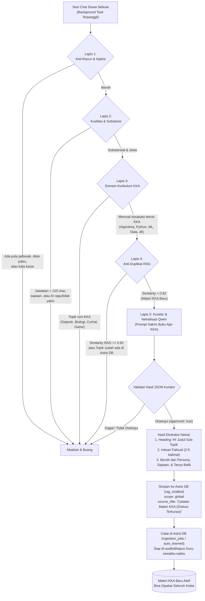
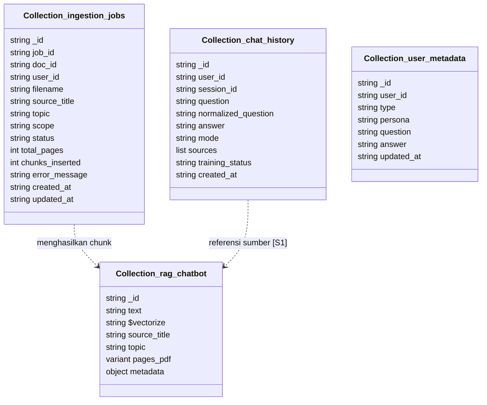

# Arsitektur Sistem Asisten Pengajar KKA (`kka_lab`)

Dokumen ini menjelaskan rancangan arsitektur, komponen modular, dan alur kerja hulu ke hilir (*end-to-end*) dari sistem AI Asisten Pengajar KKA (Koding dan Kecerdasan Artifisial). Sistem ini dirancang murni *cloud-native* dengan mengandalkan **DataStax Astra DB** sebagai basis data terpusat (baik untuk vektor RAG maupun data relasional/dokumen sesi, persona, dan antrean job), **LLM lokal (Qwen2.5-3B-Instruct)**, **Baidu Unlimited-OCR**, serta mekanisme **kurasi otomatis materi baru (*guarded auto-learning*)**.

---

## 1. Arsitektur Tingkat Tinggi (High-Level Architecture)

Sistem dirancang dengan pola *Decoupled Microservice* berbasis fitur (*Layered by Feature*). Seluruh data persistensi (vektor RAG, riwayat obrolan, status job OCR, persona siswa) disimpan terpusat di **DataStax Astra DB Cloud**, sehingga server GPU sewaan berstatus *stateless* dan aman dimatikan/dihapus kapan saja tanpa kehilangan data.



---

## 2. Alur Kerja Hulu ke Hilir (End-to-End Workflows)

### Alur A: Unggah Dokumen PDF/Materi Siswa via Unlimited-OCR $\rightarrow$ Astra DB

Alur ini memproses materi PDF digital maupun scan/foto menjadi potongan teks terstruktur yang langsung dapat dipanggil saat siswa bertanya.



---

### Alur B: Percakapan Pembelajaran dengan Scoped RAG

Alur tanya-jawab yang menerapkan isolasi dokumen (Opsi 1: privat per siswa + materi global kelas) dan prinsip bimbingan bertahap (*pedagogical scaffolding*).



---

### Alur C: Kurasi Otomatis Materi KKA Baru dari Diskusi (Pilihan B)

Mekanisme *guarded auto-learning* yang menyaring dialog siswa secara pasif dan menyerap materi KKA baru yang belum tercakup di Astra DB tanpa campur tangan manual.



---

## 3. Struktur Direktori dan Tanggung Jawab Modul

Proyek mengadopsi struktur *Layered by Feature*:

```text
kka_lab/
├── app/
│   ├── core/                        # Utilitas inti sistem
│   │   ├── config.py                # Pemuat model_record.json & konfigurasi env
│   │   └── __init__.py
│   ├── features/                    # Domain modular
│   │   ├── chat/                    # Interaksi percakapan
│   │   │   ├── assistant.py         # Inferensi Qwen2.5-3B, kuantisasi NF4, LoRA loader, gpu_lock
│   │   │   ├── prompts.py           # System prompts, budgeting token, penyesuaian konteks
│   │   │   └── router.py            # POST /api/chat
│   │   ├── ocr/                     # Pemrosesan dokumen & OCR
│   │   │   ├── client.py            # Client Baidu Unlimited-OCR (vLLM / Transformers / Native PDF)
│   │   │   ├── exceptions.py        # Exception khusus validasi dokumen & engine OCR
│   │   │   └── pdf_renderer.py      # Render PDF ke PNG beresolusi tinggi (PyMuPDF)
│   │   ├── rag/                     # Retrieval-Augmented Generation (Astra DB)
│   │   │   ├── auto_learner.py      # Saringan 5-lapis kurasi otomatis diskusi KKA (Pilihan B)
│   │   │   ├── chunker.py           # Pemotong Markdown atomik berbasis heading, tabel, & formula
│   │   │   ├── context.py           # Context builder, penyusun sitasi [S1], topic resolver
│   │   │   ├── exceptions.py        # Penanganan error transient Astra DB (503 hibernation hint)
│   │   │   ├── ingestor.py          # Operasi insert_many $vectorize & delete berulang dengan retry
│   │   │   ├── retriever.py         # Multi-query bilingual search & scope filtering
│   │   │   └── router.py            # Endpoints: /api/rag/documents, /jobs, /auto-learned
│   │   ├── memory/                  # Manajemen sesi percakapan & penyimpanan dokumen Astra DB
│   │   │   ├── gate.py              # Quality gate heuristik untuk seleksi kandidat dialog
│   │   │   ├── router.py            # Endpoints personal knowledge (/api/users/{id}/knowledge)
│   │   │   └── store.py             # Store wrapper untuk Astra DB Data API
│   │   ├── persona/                 # Preferensi karakter/gaya bahasa siswa
│   │   │   ├── router.py            # Endpoints CRUD persona siswa
│   │   │   └── validator.py         # Penyaring prompt injection, bypass pedagogis, & kata kasar
│   │   ├── language/                # Dukungan bilingual (Indonesia & English)
│   │   │   ├── detector.py          # Heuristik deteksi bahasa pertanyaan
│   │   │   ├── translator.py        # Penerjemah kueri pencarian & penjaga konsistensi bahasa
│   │   │   └── locales/             # Kamus aturan pedagogis, stop words, & teks prompt (id, en)
│   │   └── dataset/                 # Validasi dataset pelatihan LoRA
│   │       ├── tokenizer.py         # Masking target loss & tokenisasi dialog
│   │       └── validator.py         # Pengecekan syarat struktural minimal 2 langkah & pemantik
│   └── main.py                      # Inisialisasi FastAPI, CORS, lifespan, & registrasi router
├── data/                            # File dataset contoh penelitian
├── notebooks/                       # Notebook Jupyter untuk pelatihan LoRA
│   ├── Training_LoRA_CloudGPU.ipynb # Khusus GPU sewaan (RTX 5090 / CUDA 12.8+, bf16, auto-check)
│   └── Training_LoRA_Colab.ipynb    # Khusus Google Colab gratisan (T4 16GB, Google Drive)
├── scripts/                         # Skrip operasional CLI
│   ├── check_environment.py         # Diagnostik PyTorch, CUDA, VRAM, dan library
│   ├── download_model.py            # Download base model Qwen2.5-3B-Instruct
│   ├── download_ocr_model.py        # Download bobot Baidu Unlimited-OCR ke Hugging Face cache
│   └── serve_ocr_vllm.sh            # Menjalankan server vLLM Unlimited-OCR di port 8001
├── training/                        # Skrip training LoRA
│   └── train_lora.py                # Trainer LoRA / QLoRA berparameter presisi (fp16/bf16, batch)
├── requirements-core.txt            # Dependensi dasar inferensi chat & API
├── requirements-ocr.txt             # Dependensi pengolahan PDF, image, & multipart upload
└── PANDUAN_CLOUD_GPU.md             # Panduan operasional langkah-demi-langkah deployment server
```

---

## 4. Skema Koleksi Astra DB (Cloud Database)

Seluruh entitas sistem disimpan di dalam **DataStax Astra DB** (Keyspace: `rag`). Tidak ada penyimpanan basis data di disk lokal server GPU, sehingga instance bersifat *stateless*.



### Rincian Koleksi di Astra DB:

1. **`rag_chatbot` (Vektor RAG Collection):**
   * Mengaktifkan server-side `$vectorize`.
   * Berisi pecahan chunk dari materi PDF siswa/guru dan intisari diskusi KKA terkurasi.
   * `metadata`: `{ doc_id, scope: "user"|"global", uploaded_by, chunk_index, filename, origin }`.
2. **`ingestion_jobs` (Dokumen Antrean Job):**
   * Melacak progres pemrosesan OCR latar belakang (`queued` $\rightarrow$ `processing` $\rightarrow$ `completed` / `failed`).
   * Bisa dipantau bersama oleh backend TypeScript/Go tanpa perlu mengakses filesystem GPU.
3. **`chat_history` (Riwayat Sesi Obrolan):**
   * Menyimpan log tanya-jawab, deteksi pertanyaan berulang (*repeated question cache*), dan persetujuan data latih.
4. **`user_metadata` (Persona & Memori Personal):**
   * Menyimpan preferensi persona gaya belajar siswa dan memori personal (`user_knowledge`).

---

## 5. Keamanan, Isolasi, dan Alokasi Sumber Daya GPU

1. **Service-to-Service Security:**
   * Seluruh rute API dilindungi pencocokan timing-safe header `X-API-Key` dengan variabel lingkungan `AI_INTERNAL_SECRET`.
   * Operasi administratif (pengunggahan materi `global`, audit auto-learned, dan penghapusan materi kelas) wajib menyertakan `X-Admin-Key` (`RAG_ADMIN_SECRET`).
2. **Isolasi Data Antar-Siswa (Multi-Tenancy di Astra DB):**
   * Siswa B tidak akan pernah bisa mengakses atau membaca materi privat Siswa A melalui filter `$or` terisolasi di `retriever.py`:
     ```json
     {
       "$or": [
         { "metadata.scope": { "$exists": false } },
         { "metadata.scope": "global" },
         { "metadata.scope": "user", "metadata.uploaded_by": "siswa_101" }
       ]
     }
     ```
   * Penghapusan dokumen siswa diverifikasi kepemilikannya berdasarkan `user_id`.
3. **Pencegahan Concurrency Conflict & OOM di GPU:**
   * **Proses Terpisah:** vLLM Unlimited-OCR dialokasikan maksimal **45% VRAM (~14 GB pada RTX 5090)** di port 8001. Sisa **~18 GB VRAM** dialokasikan khusus untuk Qwen2.5-3B di port 8000.
   * **Thread Lock:** Seluruh generasi teks Qwen dan penerjemahan kueri diatur menggunakan `self.gpu_lock` (`threading.RLock`) pada `LocalAssistant`, mencegah dua thread FastAPI melakukan komputasi serentak yang memicu *CUDA out-of-memory*.
4. **Keuntungan Bebas SQLite di Cloud GPU:**
   * Karena semua data disimpan di Astra DB Cloud, instance GPU sewaan tidak menyimpan status apa pun (*stateless*). Jika Anda mematikan instance GPU untuk menghemat biaya sewa dan menyewa GPU baru di kemudian hari, **semua riwayat chat, materi PDF, dan data persona tetap utuh di Astra DB!**
