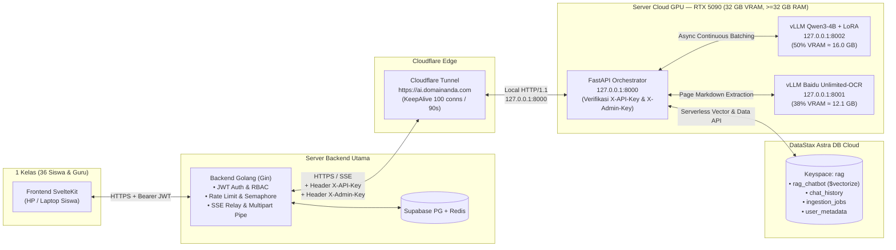

# Panduan Deployment & Integrasi: Server AI (`kka_lab`) $\leftrightarrow$ Cloudflare Tunnel $\leftrightarrow$ Backend Golang

Dokumen ini merupakan panduan operasional *end-to-end* untuk men-deploy layanan AI + OCR (`kka_lab`) pada **1x NVIDIA RTX 5090 (32 GB VRAM)** untuk melayani **1 kelas (36 siswa)** secara bersamaan, mengeksposnya secara aman melalui **Cloudflare Tunnel (`cloudflared`)**, dan menghubungkannya dengan **Backend Utama (Golang / Gin)**.

> [!NOTE]
> **Referensi Dokumentasi Resmi (via MCP Context7):**
> - **Cloudflare Tunnel (`/cloudflare/cloudflared`):** Skema `OriginRequestConfig` (`connectTimeout`, `tcpKeepAlive`, `keepAliveConnections`, `keepAliveTimeout`, `disableChunkedEncoding`).
> - **vLLM (`/websites/vllm_ai_en_stable`):** Serving OpenAI-compatible API dengan `--enable-lora`, `--lora-modules`, dan `--gpu-memory-utilization`.
> - **Gin Web Framework (`/gin-gonic/gin`):** Primitif streaming Server-Sent Events (`c.Stream`, `c.SSEvent`) dan propagasi pembatalan konteks (`c.Request.Context().Done()`, `ContextWithFallback`).

---

## 1. Topologi Arsitektur Deployment (36 Siswa Paralel)

Seluruh komunikasi dari jaringan publik ke Server GPU melewati **Cloudflare Tunnel** menuju **Port `8000` (FastAPI)**. Port internal **`8001` (vLLM OCR)** dan **`8002` (vLLM Qwen3-4B + LoRA)** hanya mendengarkan di `127.0.0.1` (tidak pernah diekspos ke internet).



---

## 2. Konfigurasi Server GPU (RTX 5090 32 GB) — Mode Dual-vLLM

Agar 36 siswa dapat bertanya secara serentak tanpa antrean serial (`gpu_lock`), jalankan **Qwen3-4B + LoRA** dan **Baidu Unlimited-OCR** sebagai dua proses `vllm serve` terpisah, lalu jalankan **FastAPI** dengan `LLM_BACKEND=vllm`.

### 2.1. Konfigurasi File `.env` di Server GPU

Buat atau sesuaikan file `.env` di root proyek `~/kka_lab/.env`:

```env
# === 1. DataStax Astra DB Cloud ===
ASTRA_DB_API_ENDPOINT=https://<ID-DATABASE>-<REGION>.apps.astra.datastax.com
ASTRA_DB_APPLICATION_TOKEN=AstraCS:xxxxxxxxxxxxxxxxxxxxxxxx
ASTRA_DB_KEYSPACE=rag
ASTRA_DB_COLLECTION=rag_chatbot
RAG_MIN_SIMILARITY=0.70

# === 2. Model Utama & Backend vLLM (Port 8002) ===
MODEL_ID=Qwen/Qwen3-4B-Instruct-2507
MODEL_ADAPTER=adapters/qwen-kka-lora-v3-qwen3-4b/final
LLM_BACKEND=vllm
LLM_BASE_URL=http://127.0.0.1:8002/v1
LLM_MODEL_NAME=kka-lora
LLM_API_KEY=EMPTY

# === 3. Parameter Sampling Pedagogis (Seragam Bab III Tabel 3.7) ===
MAX_NEW_TOKENS=768
GEN_DO_SAMPLE=true
GEN_TEMPERATURE=0.45
GEN_TOP_P=0.9
GEN_MIN_P=0.05
GEN_REPETITION_PENALTY=1.08

# === 4. Engine Baidu Unlimited-OCR via vLLM (Port 8001) ===
OCR_BACKEND=vllm
OCR_MODEL_ID=baidu/Unlimited-OCR
OCR_BASE_URL=http://127.0.0.1:8001/v1

# === 5. Keamanan Komunikasi Backend Golang -> FastAPI ===
# Gunakan string acak minimal 32 karakter (misal hasil `openssl rand -hex 32`)
AI_INTERNAL_SECRET=kunci_internal_rahasia_golang_ke_fastapi_32char
RAG_ADMIN_SECRET=kunci_khusus_role_guru_upload_global_32char

# === 6. Kontrol Eksperimen Kelas ===
# Matikan auto-learn saat eksperimen kelas agar korpus terkontrol & hemat beban GPU
RAG_AUTO_LEARN_ENABLED=false
RAG_AUTO_LEARN_MAX_SIMILARITY=0.82
```

### 2.2. Menyalakan 3 Proses Layanan AI di `tmux`

Gunakan `tmux` agar seluruh proses tetap berjalan di latar belakang meskipun terminal SSH/Jupyter ditutup.

#### Proses 1 — Engine Unlimited-OCR (`127.0.0.1:8001`, Alokasi 38% VRAM $\approx$ 12,1 GB)
```bash
tmux new -s ocr
cd ~/kka_lab
OCR_GPU_MEMORY_UTILIZATION=0.38 bash scripts/serve_ocr_vllm.sh
```
*Tunggu hingga muncul `Application startup complete` pada port `8001`, lalu lepas layar `tmux` dengan **`Ctrl+B`** lalu **`D`**.*

#### Proses 2 — Engine LLM `Qwen3-4B-Instruct-2507` + LoRA (`127.0.0.1:8002`, Alokasi 50% VRAM $\approx$ 16,0 GB)
Berdasarkan dokumentasi vLLM (`/websites/vllm_ai_en_stable`), flag `--enable-lora` dan `--lora-modules kka-lora=<path>` akan mendaftarkan adaptor QLoRA dengan nama model `kka-lora` pada endpoint OpenAI-compatible `/v1/chat/completions`:

```bash
tmux new -s llm
cd ~/kka_lab
MODEL_ID=Qwen/Qwen3-4B-Instruct-2507 \
MODEL_ADAPTER=adapters/qwen-kka-lora-v3-qwen3-4b/final \
LLM_GPU_MEMORY_UTILIZATION=0.50 \
LLM_MAX_MODEL_LEN=16384 \
bash scripts/serve_llm_vllm.sh
```
*Tunggu hingga muncul `Application startup complete` pada port `8002`, lalu tekan **`Ctrl+B`** lalu **`D`**.*

#### Proses 3 — FastAPI Orchestrator (`127.0.0.1:8000`)
Karena menggunakan `LLM_BACKEND=vllm`, proses FastAPI tidak memuat bobot model ke GPU dan hanya bertindak sebagai *async orchestrator* (mengelola Astra DB, perakitan prompt, sanitasi, dan pemanggilan ke port `8001`/`8002`). Bind ke `127.0.0.1` agar hanya bisa diakses melalui `cloudflared`:

```bash
tmux new -s api
cd ~/kka_lab
uvicorn app.main:app --host 127.0.0.1 --port 8000 --workers 2 --timeout-keep-alive 75
```
*Tekan **`Ctrl+B`** lalu **`D`** untuk melepas layar `tmux`.*

---

## 3. Konfigurasi Cloudflare Tunnel (`cloudflared`)

Berdasarkan dokumentasi resmi **`/cloudflare/cloudflared`** (`OriginRequestConfig` pada `ingress/config.go`), pengaturan koneksi dari `cloudflared` ke origin lokal (`127.0.0.1:8000`) sangat menentukan kestabilan **SSE Streaming (`/api/chat/stream`)** dan **Upload PDF OCR (`/api/rag/documents`)**.

### Parameter Kritis `OriginRequestConfig` (`/cloudflare/cloudflared`)

| Parameter YAML (`config.yml`) | Flag CLI `cloudflared` | Nilai Rekomendasi | Alasan Teknis untuk AI + OCR (36 Siswa) |
| :--- | :--- | :---: | :--- |
| `connectTimeout` | `--proxy-connect-timeout` | `30s` | Batas waktu jabat tangan TCP awal ke FastAPI `:8000`. |
| `tcpKeepAlive` | `--proxy-tcp-keepalive` | `30s` | Menjaga soket TCP tetap hidup selama siswa menunggu generasi token LLM. |
| `keepAliveConnections` | `--proxy-keepalive-connections` | `100` | Menyediakan *pool* hingga 100 koneksi *keep-alive* agar *burst* 36 siswa tidak perlu membuka koneksi TCP baru berulang-ulang. |
| `keepAliveTimeout` | `--proxy-keepalive-timeout` | `90s` | Menjaga koneksi *idle* di *pool* tetap terbuka selama 90 detik antar giliran tanya-jawab siswa. |
| `disableChunkedEncoding` | `--no-chunked-encoding` | **`false`** *(Jangan diaktifkan)* | **Wajib `false`** agar *chunked transfer encoding* pada SSE streaming (`/api/chat/stream`) tidak terputus. |

---

### Cara A — Remotely-Managed Tunnel via Token Dashboard (Rekomendasi untuk Cloud GPU / Vast.ai)

Container Cloud GPU (seperti Vast.ai atau RunPod) umumnya tidak menjalankan `systemd` dan IP publiknya berubah setiap sewa ulang. Dengan metode Token, Anda cukup menyalakan `cloudflared` di dalam `tmux` dan domain `https://ai.domainanda.com` langsung aktif.

#### Langkah 1: Buat Tunnel & Atur Public Hostname di Dashboard Cloudflare
1. Buka **[Cloudflare Zero Trust Dashboard](https://one.dash.cloudflare.com)** $\rightarrow$ **Networks** $\rightarrow$ **Tunnels** $\rightarrow$ **Create a tunnel** (pilih **Cloudflared**).
2. Beri nama tunnel (misal `kka-rtx5090-tunnel`) lalu salin **Tunnel Token** (`eyJhIjoi...`).
3. Buka tab **Public Hostname** $\rightarrow$ **Add a public hostname**:
   - **Subdomain:** `ai`
   - **Domain:** `domainanda.com` *(hasil: `https://ai.domainanda.com`)*
   - **Service Type:** `HTTP`
   - **URL:** `127.0.0.1:8000`
4. Klik **Additional application settings** $\rightarrow$ **HTTP Settings**, lalu sesuaikan:
   - **Connect Timeout:** `30` seconds
   - **TCP Keep-Alive:** `30` seconds
   - **Keep Alive Connections:** `100`
   - **Keep Alive Timeout:** `90` seconds
   - **Disable Chunked Encoding:** **OFF (Jangan dicentang)**
5. Klik **Save hostname**.

#### Langkah 2: Jalankan `cloudflared` di Server GPU (di dalam `tmux`)
```bash
# 1. Instal binary cloudflared (1x per instance)
curl -fsSL https://github.com/cloudflare/cloudflared/releases/latest/download/cloudflared-linux-amd64.deb -o cloudflared.deb
dpkg -i cloudflared.deb
rm -f cloudflared.deb

# 2. Jalankan tunnel di dalam tmux dengan parameter proxy optimal
tmux new -s tunnel
cloudflared tunnel \
  --proxy-connect-timeout 30s \
  --proxy-tcp-keepalive 30s \
  --proxy-keepalive-connections 100 \
  --proxy-keepalive-timeout 90s \
  run --token <PASTE_TOKEN_TUNNEL_ANDA_DI_SINI>
```
*Pastikan muncul `Registered tunnel connection`, lalu tekan **`Ctrl+B`** lalu **`D`**.*

---

### Cara B — Locally-Managed Tunnel via `config.yml` (Alternatif Server Permanen)

Jika Anda menggunakan konfigurasi berbasis berkas `~/.cloudflared/config.yml`, gunakan struktur resmi berikut:

```yaml
tunnel: <UUID-TUNNEL-ANDA>
credentials-file: /root/.cloudflared/<UUID-TUNNEL-ANDA>.json

originRequest:
  connectTimeout: 30s
  tlsTimeout: 10s
  tcpKeepAlive: 30s
  keepAliveConnections: 100
  keepAliveTimeout: 90s
  disableChunkedEncoding: false
  http2Origin: false

ingress:
  - hostname: ai.domainanda.com
    service: http://127.0.0.1:8000
  - service: http_status:404
```

Jalankan di `tmux`:
```bash
tmux new -s tunnel
cloudflared tunnel --config ~/.cloudflared/config.yml run
```

> [!IMPORTANT]
> **Pengaturan Cache Rule di Cloudflare Dashboard untuk SSE Streaming:**
> Agar Cloudflare Edge tidak menampung (*buffer*) respons SSE `/api/chat/stream`:
> 1. Endpoint `/api/chat/stream` di [`app/features/chat/router.py`](file:///c:/project-uta/kka_lab/app/features/chat/router.py#L234) sudah mengirimkan header `Cache-Control: no-cache` dan `X-Accel-Buffering: no`.
> 2. Di Dashboard Cloudflare domain Anda, buka **Caching** $\rightarrow$ **Cache Rules**, buat aturan untuk `Hostname equals ai.domainanda.com` $\rightarrow$ pilih **Bypass Cache**.

---

## 4. Integrasi dari Backend Golang (Gin) ke Server AI (`https://ai.domainanda.com`)

Backend Golang bertindak sebagai *API Gateway* tunggal yang menghadapi browser/HP siswa. Siswa tidak pernah memanggil `https://ai.domainanda.com` secara langsung dan tidak pernah memegang `AI_INTERNAL_SECRET` maupun `RAG_ADMIN_SECRET`.

### 4.1. Variabel `.env` pada Backend Golang

```env
# URL Cloudflare Tunnel yang mengarah ke FastAPI :8000
AI_BASE_URL=https://ai.domainanda.com

# Harus SAMA PERSIS dengan nilai di .env Server GPU
AI_INTERNAL_SECRET=kunci_internal_rahasia_golang_ke_fastapi_32char
RAG_ADMIN_SECRET=kunci_khusus_role_guru_upload_global_32char

# Konkurensi untuk 1 Kelas (36 Siswa) di RTX 5090 (Mode Dual-vLLM)
MAX_INFLIGHT_CHAT=36
MAX_INFLIGHT_OCR=3
```

---

### 4.2. HTTP Client Pool Khusus Komunikasi ke Cloudflare Tunnel (`internal/core/aiclient/client.go`)

Sesuaikan `http.Transport` di Golang agar selaras dengan `keepAliveConnections: 100` dan `keepAliveTimeout: 90s` pada `cloudflared`. Jangan memasang `Timeout` statis pada struct `http.Client` utama agar koneksi streaming SSE tidak diputus paksa; gunakan `context.WithTimeout` pada masing-masing *request* non-streaming.

```go
package aiclient

import (
	"context"
	"net"
	"net/http"
	"strings"
	"time"
)

type Client struct {
	baseURL        string
	internalSecret string
	adminSecret    string
	httpClient     *http.Client
}

func NewClient(baseURL, internalSecret, adminSecret string) *Client {
	transport := &http.Transport{
		Proxy: http.ProxyFromEnvironment,
		DialContext: (&net.Dialer{
			Timeout:   10 * time.Second,
			KeepAlive: 30 * time.Second,
		}).DialContext,
		ForceAttemptHTTP2:     true,
		MaxIdleConns:          100,
		MaxIdleConnsPerHost:   50,
		IdleConnTimeout:       90 * time.Second,
		TLSHandshakeTimeout:   10 * time.Second,
		ResponseHeaderTimeout: 45 * time.Second,
		ExpectContinueTimeout: 1 * time.Second,
	}

	return &Client{
		baseURL:        strings.TrimRight(baseURL, "/"),
		internalSecret: internalSecret,
		adminSecret:    adminSecret,
		httpClient: &http.Client{
			Transport: transport,
			// Jangan set Timeout global di sini agar stream SSE (/api/chat/stream) tidak terputus.
		},
	}
}

func (c *Client) NewRequest(ctx context.Context, method, path string, body any, isAdmin bool) (*http.Request, error) {
	// Helper pembentuk request yang selalu menyuntikkan X-API-Key (& X-Admin-Key untuk rute guru)
	var req *http.Request
	var err error
	if r, ok := body.(importReader); ok {
		req, err = http.NewRequestWithContext(ctx, method, c.baseURL+path, r)
	} else {
		req, err = http.NewRequestWithContext(ctx, method, c.baseURL+path, nil)
	}
	if err != nil {
		return nil, err
	}
	req.Header.Set("X-API-Key", c.internalSecret)
	if isAdmin && c.adminSecret != "" {
		req.Header.Set("X-Admin-Key", c.adminSecret)
	}
	return req, nil
}

type importReader interface {
	Read(p []byte) (n int, err error)
}
```

---

### 4.3. Relay SSE Streaming Chat (`/api/chat/stream`) di Gin

Berdasarkan dokumentasi **`/gin-gonic/gin`** (`context.go`), aktifkan `r.ContextWithFallback = true` pada `gin.Engine` agar `c.Done()` dan `c.Request.Context().Done()` otomatis membatalkan koneksi *upstream* ke FastAPI/vLLM saat siswa menutup tab browser, serta gunakan `c.Stream` atau `c.Writer.Flush()` dengan header anti-buffering.

Format event SSE yang dikirim oleh [`app/features/chat/router.py`](file:///c:/project-uta/kka_lab/app/features/chat/router.py#L158-L235) (`POST /api/chat/stream`) adalah:
1. `event: sources` $\rightarrow$ `{"session_id": "...", "sources": [...]}`
2. `event: delta` $\rightarrow$ `{"text": "potongan token..."}` *(berulang sepanjang generasi)*
3. `event: done` $\rightarrow$ `{"session_id": "...", "answer": "...", "sources": [...], "memory_hit": false, "training": {...}}`
4. `event: error` $\rightarrow$ `{"detail": "..."}` *(jika terjadi kegagalan)*

Berikut implementasi handler relay SSE di Golang (`internal/features/chat/handler.go`):

```go
package chat

import (
	"bufio"
	"bytes"
	"context"
	"encoding/json"
	"io"
	"net/http"
	"strings"
	"time"

	"github.com/gin-gonic/gin"
)

type AIChatPayload struct {
	UserID            string `json:"user_id"`
	StudentName       string `json:"student_name,omitempty"`
	Question          string `json:"question"`
	SessionID         string `json:"session_id,omitempty"`
	Mode              string `json:"mode"` // "terstruktur" atau "umum" (ditentukan Go sesuai kelompok kelas siswa)
	ConsentToTraining bool   `json:"consent_to_training"`
	ResetContext      bool   `json:"reset_context"`
}

func (h *Handler) StreamChatToStudent(c *gin.Context) {
	// 1. Batasi konkurensi maksimal 36 request chat aktif bersamaan (1 kelas penuh)
	select {
	case h.chatSem <- struct{}{}:
		defer func() { <-h.chatSem }()
	case <-time.After(5 * time.Second):
		c.JSON(http.StatusServiceUnavailable, gin.H{"error": "Server AI sedang melayani banyak siswa, coba beberapa detik lagi."})
		return
	case <-c.Request.Context().Done():
		return
	}

	// 2. Bangun payload dengan user_id, student_name, dan mode dari JWT/Database (bukan dari input mentah frontend)
	payload := AIChatPayload{
		UserID:      c.GetString("jwt_user_id"),
		StudentName: c.GetString("jwt_full_name"),
		Question:    c.GetString("validated_question"),
		SessionID:   c.GetString("ai_session_id"),
		Mode:        c.GetString("assigned_experiment_mode"), // "terstruktur" atau "umum"
	}
	bodyBytes, err := json.Marshal(payload)
	if err != nil {
		c.JSON(http.StatusInternalServerError, gin.H{"error": "Gagal menyiapkan request."})
		return
	}

	// 3. Gunakan c.Request.Context() agar jika siswa menutup browser, request ke Cloudflare Tunnel -> vLLM ikut batal
	ctx, cancel := context.WithTimeout(c.Request.Context(), 95*time.Second)
	defer cancel()

	req, err := http.NewRequestWithContext(ctx, http.MethodPost, h.aiBaseURL+"/api/chat/stream", bytes.NewReader(bodyBytes))
	if err != nil {
		c.JSON(http.StatusInternalServerError, gin.H{"error": "Gagal membuat request ke AI."})
		return
	}
	req.Header.Set("Content-Type", "application/json")
	req.Header.Set("Accept", "text/event-stream")
	req.Header.Set("X-API-Key", h.aiInternalSecret)
	req.Header.Set("X-Request-ID", c.GetString("request_id"))

	resp, err := h.httpClient.Do(req)
	if err != nil {
		c.JSON(http.StatusBadGateway, gin.H{"error": "Gagal terhubung ke server AI."})
		return
	}
	defer resp.Body.Close()

	if resp.StatusCode != http.StatusOK {
		errBody, _ := io.ReadAll(io.LimitReader(resp.Body, 4096))
		c.Data(resp.StatusCode, "application/json", errBody)
		return
	}

	// 4. Set header wajib SSE agar Cloudflare & Reverse Proxy tidak mem-buffer stream
	c.Writer.Header().Set("Content-Type", "text/event-stream; charset=utf-8")
	c.Writer.Header().Set("Cache-Control", "no-cache, no-transform")
	c.Writer.Header().Set("Connection", "keep-alive")
	c.Writer.Header().Set("X-Accel-Buffering", "no")

	// 5. Baca baris SSE dari FastAPI dan relay langsung menggunakan c.Stream / c.SSEvent (/gin-gonic/gin)
	reader := bufio.NewReader(resp.Body)
	var currentEvent string

	c.Stream(func(w io.Writer) bool {
		for {
			line, readErr := reader.ReadString('\n')
			if readErr != nil {
				return false
			}
			line = strings.TrimRight(line, "\r\n")

			if strings.HasPrefix(line, "event:") {
				currentEvent = strings.TrimSpace(strings.TrimPrefix(line, "event:"))
				continue
			}
			if strings.HasPrefix(line, "data:") {
				rawData := strings.TrimSpace(strings.TrimPrefix(line, "data:"))
				evName := currentEvent
				if evName == "" {
					evName = "message"
				}
				currentEvent = ""

				// Tulis frame SSE mentah dan kembali ke c.Stream agar w.Flush() langsung dipanggil
				_, _ = w.Write([]byte("event: " + evName + "\ndata: " + rawData + "\n\n"))
				return true
			}
		}
	})
}
```

---

### 4.4. Zero-Buffer Streaming Proxy untuk Upload Dokumen OCR (`/api/rag/documents`)

Untuk mencegah 36 siswa mengunggah PDF ukuran besar di detik yang sama dan menghabiskan RAM sistem:
1. Batasi konkurensi unggah OCR di Golang menggunakan *channel semaphore* berkapasitas `MAX_INFLIGHT_OCR=3`.
2. Terapkan `http.MaxBytesReader` (`21 MB`) dan alirkan *multipart stream* langsung ke `https://ai.domainanda.com/api/rag/documents` menggunakan `io.Pipe()`:

```go
func (h *RAGHandler) UploadDocument(c *gin.Context) {
	// 1. Batasi maksimal 3 proses upload OCR bersamaan
	select {
	case h.ocrSem <- struct{}{}:
		defer func() { <-h.ocrSem }()
	case <-time.After(10 * time.Second):
		c.JSON(http.StatusTooManyRequests, gin.H{"error": "Antrean pemrosesan dokumen OCR sedang penuh, tunggu beberapa detik."})
		return
	}

	// 2. Tolak file > 21 MB sebelum dibaca penuh ke memori
	c.Request.Body = http.MaxBytesReader(c.Writer, c.Request.Body, 21<<20)

	userID := c.GetString("jwt_user_id")
	role := c.GetString("jwt_role") // "siswa" atau "guru"
	isGuru := role == "guru"

	// Siswa selalu dipaksa scope="user"; hanya guru di rute admin yang boleh scope="global"
	scope := "user"
	if isGuru && c.Query("scope") == "global" {
		scope = "global"
	}

	fileHeader, err := c.FormFile("file")
	if err != nil {
		c.JSON(http.StatusBadRequest, gin.H{"error": "File dokumen wajib disertakan (maks 20 MB)."})
		return
	}
	srcFile, err := fileHeader.Open()
	if err != nil {
		c.JSON(http.StatusBadRequest, gin.H{"error": "Gagal membaca file unggahan."})
		return
	}
	defer srcFile.Close()

	// 3. Alirkan multipart via io.Pipe tanpa memuat seluruh file ke RAM Golang
	pr, pw := io.Pipe()
	mw := multipart.NewWriter(pw)

	go func() {
		defer pw.Close()
		defer mw.Close()

		_ = mw.WriteField("user_id", userID)
		_ = mw.WriteField("scope", scope)
		_ = mw.WriteField("source_title", c.PostForm("source_title"))
		_ = mw.WriteField("topic", c.PostForm("topic"))

		part, partErr := mw.CreateFormFile("file", fileHeader.Filename)
		if partErr != nil {
			_ = pw.CloseWithError(partErr)
			return
		}
		if _, copyErr := io.Copy(part, srcFile); copyErr != nil {
			_ = pw.CloseWithError(copyErr)
			return
		}
	}()

	ctx, cancel := context.WithTimeout(c.Request.Context(), 45*time.Second)
	defer cancel()

	req, err := http.NewRequestWithContext(ctx, http.MethodPost, h.aiBaseURL+"/api/rag/documents", pr)
	if err != nil {
		c.JSON(http.StatusInternalServerError, gin.H{"error": "Gagal meneruskan dokumen ke server AI."})
		return
	}
	req.Header.Set("Content-Type", mw.FormDataContentType())
	req.Header.Set("X-API-Key", h.aiInternalSecret)
	if scope == "global" && isGuru {
		req.Header.Set("X-Admin-Key", h.ragAdminSecret)
	}

	resp, err := h.httpClient.Do(req)
	if err != nil {
		c.JSON(http.StatusBadGateway, gin.H{"error": "Gagal menghubungi layanan OCR."})
		return
	}
	defer resp.Body.Close()

	respBody, _ := io.ReadAll(io.LimitReader(resp.Body, 8192))
	c.Data(resp.StatusCode, "application/json", respBody)
}
```

---

## 5. Matriks Kontrak Endpoint & Header (Backend Golang $\rightarrow$ FastAPI `kka_lab`)

| Fitur | Method & Path di FastAPI (`https://ai.domainanda.com`) | Header Wajib dari Golang | Timeout Rekomendasi di Golang | Keterangan |
| :--- | :--- | :--- | :---: | :--- |
| **Health Check** | `GET /api/health` | *(Tidak wajib)* | `5s` | Mengembalikan `{"status":"ok"}`. |
| **Chat SSE Stream** | `POST /api/chat/stream` | `X-API-Key` | `95s` *(via Context)* | **Utama untuk kelas (36 siswa).** Mengirim event `sources`, `delta`, `done`, `error`. |
| **Chat JSON Non-Stream** | `POST /api/chat` | `X-API-Key` | `90s` | Alternatif JSON sekali kirim (`{session_id, answer, sources}`). |
| **Upload PDF/Gambar Siswa** | `POST /api/rag/documents` (`scope=user`) | `X-API-Key` | `45s` | Mengembalikan `202 Accepted` (`{job_id, doc_id, status: "queued"}`). |
| **Upload Modul Global Guru** | `POST /api/rag/documents` (`scope=global`) | `X-API-Key`, `X-Admin-Key` | `45s` | Hanya boleh dipanggil jika role JWT di Golang = `guru`. |
| **Polling Status OCR** | `GET /api/rag/jobs/{job_id}?user_id={uid}` | `X-API-Key` | `10s` | Cek status `queued` $\rightarrow$ `processing` $\rightarrow$ `completed` / `failed`. |
| **Daftar Dokumen Siswa** | `GET /api/users/{user_id}/documents` | `X-API-Key` | `10s` | Daftar dokumen milik siswa terkait. |
| **Hapus Dokumen Siswa** | `DELETE /api/rag/documents/{doc_id}?user_id={uid}` | `X-API-Key` | `15s` | Menghapus chunk di Astra DB & catatan job. |
| **Persona Siswa** | `GET/PUT/DELETE /api/users/{user_id}/persona` | `X-API-Key` | `10s` | Mengatur preferensi gaya komunikasi siswa. |
| **Memori Personal Siswa** | `POST /api/users/{user_id}/knowledge`, `DELETE /api/users/{user_id}/memory` | `X-API-Key` | `10s` | Menyimpan/mereset memori pengetahuan personal siswa. |

---

## 6. Checklist Verifikasi Sebelum Sesi Kelas (36 Siswa) Dimulai

Jalankan 5 pemeriksaan berikut secara berurutan sebelum siswa masuk ke aplikasi:

### 1. Verifikasi Keempat Session `tmux` Aktif di Server GPU
```bash
tmux ls
```
Pastikan keempat proses terdaftar:
- `ocr` (`vllm serve baidu/Unlimited-OCR` di `:8001`)
- `llm` (`vllm serve Qwen/Qwen3-4B-Instruct-2507 + LoRA` di `:8002`)
- `api` (`uvicorn app.main:app` di `:8000`)
- `tunnel` (`cloudflared tunnel run` ke `:8000`)

### 2. Verifikasi Alokasi VRAM RTX 5090 (`nvidia-smi`)
```bash
nvidia-smi
```
Pastikan penggunaan memori GPU berada di kisaran **~28–30 GB / 32 GB** (dua proses `vllm` aktif) dan masih tersisa *headroom* ~2–3 GB.

### 3. Verifikasi Keamanan `X-API-Key` Lewat Domain Cloudflare Tunnel
Dari terminal laptop atau server Backend Golang:
```bash
# A. Tes Health Check (Harus 200 OK: {"status":"ok"})
curl -i https://ai.domainanda.com/api/health

# B. Tes Tanpa X-API-Key (Harus ditolak 403 Forbidden!)
curl -i -X POST https://ai.domainanda.com/api/chat \
  -H "Content-Type: application/json" \
  -d '{"user_id":"tes","question":"Halo","mode":"umum"}'
```

### 4. Verifikasi SSE Streaming (`/api/chat/stream`) Lewat Cloudflare Tunnel
Gunakan flag `-N` (`--no-buffer`) pada `curl` untuk memastikan token mengalir satu per satu (`event: sources` $\rightarrow$ `event: delta` $\rightarrow$ `event: done`) tanpa tertahan di Cloudflare:
```bash
curl -N -X POST https://ai.domainanda.com/api/chat/stream \
  -H "Content-Type: application/json" \
  -H "X-API-Key: kunci_internal_rahasia_golang_ke_fastapi_32char" \
  -d '{
    "user_id": "uji_kelas_01",
    "student_name": "Budi",
    "question": "Apa langkah pertama dalam merancang sistem kecerdasan artifisial?",
    "mode": "terstruktur"
  }'
```

### 5. Verifikasi Pipeline OCR (`POST /api/rag/documents`)
```bash
curl -X POST https://ai.domainanda.com/api/rag/documents \
  -H "X-API-Key: kunci_internal_rahasia_golang_ke_fastapi_32char" \
  -F "file=@contoh_materi.pdf" \
  -F "user_id=uji_kelas_01" \
  -F "scope=user" \
  -F "source_title=Uji Koneksi OCR" \
  -F "topic=Perancangan Sistem KA"
```
Pastikan langsung mengembalikan HTTP `202 Accepted` berisi `job_id`, lalu cek `GET /api/rag/jobs/<job_id>?user_id=uji_kelas_01` hingga berstatus `completed`.
