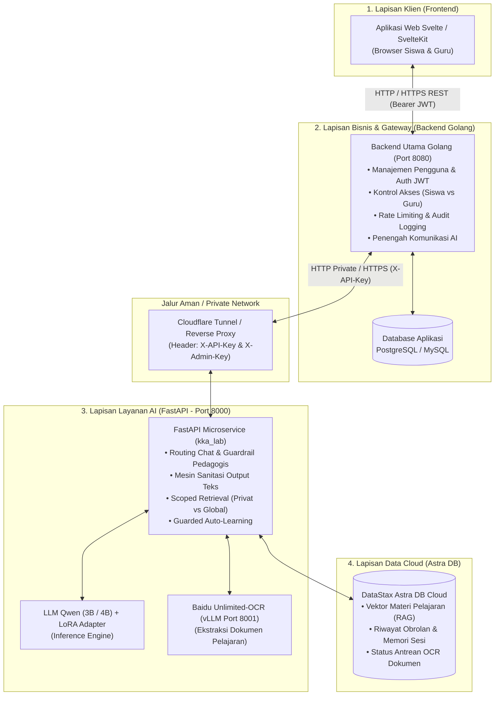

# Asisten Pengajar KKA (`kka_lab`)
### AI Pengajar Koding & Kecerdasan Artifisial berbasis Qwen (3B / 4B) + LoRA + RAG Astra DB + Baidu Unlimited-OCR

Sistem asisten AI cerdas untuk pembelajaran **Koding dan Kecerdasan Artifisial (KKA)** tingkat SMA/SMK. Sistem ini menggabungkan model bahasa besar (*Large Language Model*) yang telah di-*fine-tune* dengan prinsip pedagogis bertingkat (*scaffolding*), penelusuran dokumen cerdas (*Retrieval-Augmented Generation* / RAG), ekstraksi teks visual dari modul/PDF berbasis OCR (*Baidu Unlimited-OCR*), serta arsitektur integrasi modern berstandar industri (**Svelte Frontend $\leftrightarrow$ Golang Backend $\leftrightarrow$ FastAPI AI Service**).

---

## Daftar Isi
1. [Tech Stack Proyek](#1-tech-stack-proyek)
2. [Arsitektur Sistem & Integrasi 3-Tier](#2-arsitektur-sistem--integrasi-3-tier)
3. [Panduan Integrasi Backend Golang](#3-panduan-integrasi-backend-golang)
4. [Panduan Integrasi Frontend Svelte](#4-panduan-integrasi-frontend-svelte)
5. [Kontrak API AI Service (FastAPI Port 8000)](#5-kontrak-api-ai-service-fastapi-port-8000)
6. [Prinsip Pedagogis & Mode Pembelajaran](#6-prinsip-pedagogis--mode-pembelajaran)
7. [Struktur Proyek](#7-struktur-proyek)
8. [Panduan Menjalankan Sistem di Lokal (WSL2)](#8-panduan-menjalankan-sistem-di-lokal-wsl2)
9. [Panduan Training & Evaluasi Cloud GPU](#9-panduan-training--evaluasi-cloud-gpu)
10. [Pengujian Unit](#10-pengujian-unit)

---

## 1. Tech Stack Proyek

Berikut adalah rincian lengkap teknologi yang digunakan dalam proyek ini dari hulu ke hilir:

### A. AI Core, Fine-Tuning & Inference
- **Base LLM:**
  - `Qwen/Qwen2.5-3B-Instruct` (Alibaba Cloud) — baseline model 3.1B parameter.
  - `Qwen/Qwen3-4B-Instruct-2507` (Alibaba Cloud) — model generasi terbaru 4B parameter (**Pemenang Dataset v3: Pass Rate 100%**).
- **Fine-Tuning:**
  - **QLoRA (Quantized Low-Rank Adaptation):** 4-bit NormalFloat (NF4) quantization dengan double quantization via `bitsandbytes`.
  - **PEFT (Parameter-Efficient Fine-Tuning):** `peft==0.17.1` (`r=16`, `lora_alpha=32`, `target_modules=all-linear`).
  - **Hugging Face Ecosystem:** `transformers==4.57.1`, `accelerate==1.10.1`.
  - **Regularisasi Anti-Overfitting & Anti-OOM:**
    - **NEFTune:** Injeksi derau seragam pada embedding (`neftune_noise_alpha=5.0`).
    - **Gradient Clipping:** `max_grad_norm=1.0`.
    - **Gradient Checkpointing:** Reentrant checkpointing untuk efisiensi VRAM.
    - **Masked CausalLM Loss:** Hanya memproyeksikan token jawaban asisten (menghemat >2 GB VRAM).
- **Inference Acceleration:**
  - PyTorch CUDA (BF16 & FP16) dengan SDPA (*Scaled Dot-Product Attention* / Flash Attention).

### B. Multimodal Vision & Document OCR
- **Baidu Unlimited-OCR (`baidu/Unlimited-OCR`):** Vision-Language Model berbasis arsitektur R-SWA untuk ekstraksi tabel, rumus matematika, diagram, dan teks pelajaran dari modul digital maupun scan.
- **vLLM Serving Engine:** Server inferensi berkecepatan tinggi untuk menjalankan model OCR di port `8001`.
- **PyMuPDF (`fitz`):** Rendering halaman file PDF menjadi gambar resolusi tinggi (150 DPI) sebelum di-OCR.

### C. Database & Vector Storage
- **DataStax Astra DB (Serverless Cassandra Cloud):**
  - **100% Cloud-Native & Stateless:** Seluruh penyimpanan data terpusat di DataStax Astra DB, tanpa memerlukan database lokal. Server AI bersifat *stateless* sehingga aman dimatikan/dihapus kapan saja tanpa risiko kehilangan data.
  - **Vector Search ($vectorize):** Penyimpanan vektor materi RAG dengan komputasi embedding otomatis di sisi server.
  - **Riwayat & Sesi Obrolan:** Menyimpan memori percakapan multi-sesi siswa dan deteksi pertanyaan berulang.
  - **Pelacakan Antrean OCR:** Menyimpan status pemrosesan dokumen PDF secara terstruktur.
  - **Metadata & Persona:** Mengelola persona belajar dan preferensi siswa secara persisten.

### D. AI Microservice Layer (Python)
- **FastAPI (`0.116.1`):** Framework web asinkron berkecepatan tinggi dengan validasi skema tipe Pydantic v2.
- **Uvicorn:** Server ASGI *production-grade*.
- **HTTPX:** Klien HTTP asinkron untuk komunikasi internal antara FastAPI dan engine vLLM OCR.
- **Pedagogical Sanitizer & Guardrails:** Mesin penyaring respons berbasis regex untuk mencegah kebocoran prompt internal, menyaring metadata kotor/tag OCR (`[Halaman buku N]`, `[S1]`), dan mencegah manipulasi prompt (*jailbreak mitigation*).

### E. Main Application Backend (Golang)
- **Golang (Go 1.22+):** Backend utama aplikasi siswa/sekolah yang menangani autentikasi pengguna, kontrol akses berbasis peran (RBAC siswa vs guru), rate limiting, dan orkestrasi bisnis.
- **Framework Web Go:** Gin Web Framework / Fiber / standar `net/http`.
- **Otentikasi:** JWT (*JSON Web Tokens*) & Bcrypt.
- **Konektor HTTP AI:** Klien HTTP Go yang aman dengan penyisipan secret internal `X-API-Key` dan `X-Admin-Key`.

### F. Frontend Layer (Svelte)
- **Svelte / SvelteKit:** Framework UI reaktif modern berbasis komponen yang ringan, cepat, dan hemat resource.
- **TypeScript & TailwindCSS:** Pengetikan kode yang aman dan styling antarmuka chat responsif.
- **Markdown & Math Parser:** `marked` / `markdown-it` dengan dukungan sintaks kode (Prism/Shiki) dan KaTeX untuk rumus matematika.

### G. Infrastruktur, Jaringan & Keamanan
- **Cloudflare Tunnel (`cloudflared`):** Menghubungkan port internal server GPU (`8000`) ke domain publik (`https://ai.domainanda.com`) tanpa perlu IP publik statis atau pembukaan port firewall router.
- **WSL2 (Windows Subsystem for Linux):** Lingkungan pengembangan lokal berbasis Debian / Ubuntu dengan akselerasi NVIDIA GPU CUDA.
- **Process Manager:** `tmux` untuk menjalankan layanan FastAPI dan vLLM OCR di latar belakang server secara persisten.

---

## 2. Arsitektur Sistem & Integrasi 3-Tier

Untuk menjaga **keamanan tingkat tinggi**, browser/klien siswa **TIDAK PERNAH** memanggil API AI secara langsung. Backend Golang berfungsi sebagai *Gateway & Security Shield* yang memvalidasi hak akses siswa sebelum meneruskan kueri ke layanan AI FastAPI.



### Mengapa Harus Lewat Backend Golang Terlebih Dahulu?
1. **Perlindungan Kunci Rahasia (*Secret Isolation*):** `AI_INTERNAL_SECRET` (`X-API-Key`) dan `RAG_ADMIN_SECRET` (`X-Admin-Key`) hanya disimpan di server backend Golang, tidak pernah bocor ke bundle JavaScript browser klien.
2. **Autentikasi Terpusat (*User Identification*):** Backend Golang memverifikasi token JWT siswa dan menyuntikkan `user_id` terverifikasi ke dalam payload AI. Siswa tidak bisa memalsukan `user_id` siswa lain untuk mengintip materi privat.
3. **Penyaringan Peran (*RBAC*):** Hanya pengguna dengan peran `guru` / `admin` yang diizinkan mengunggah materi pelajaran global (`scope: "global"`). Siswa hanya bisa mengunggah dokumen pribadi (`scope: "user"`).
4. **Pencegahan Penyalahgunaan (*Rate Limiting*):** Golang dapat membatasi kuota pertanyaan per siswa (misalnya maksimal 30 pertanyaan per jam) sebelum membebani GPU AI.

---

## 3. Panduan Integrasi Backend Golang

Berikut adalah implementasi lengkap konektor AI di sisi Backend Golang menggunakan framework standar / Gin.

### A. Struktur Data & Kontrak JSON (`models.go`)
```go
package models

// Request chat dari Frontend Svelte ke Backend Golang
type ChatRequestFromFrontend struct {
	Question string `json:"question" binding:"required"`
	Mode     string `json:"mode"` // "terstruktur" (default) atau "umum"
}

// Request yang diteruskan Golang ke FastAPI AI Service
type AIChatPayload struct {
	UserID            string `json:"user_id"`
	SessionID         string `json:"session_id,omitempty"`
	Question          string `json:"question"`
	Mode              string `json:"mode"`
	ConsentToTraining bool   `json:"consent_to_training"`
}

// Respons dari FastAPI AI Service
type AIChatResponse struct {
	SessionID  string   `json:"session_id"`
	Answer     string   `json:"answer"`
	Mode       string   `json:"mode"`
	Sources    []string `json:"sources,omitempty"`
	Confidence float64  `json:"confidence,omitempty"`
}
```

### B. Klien HTTP Penghubung AI (`ai_client.go`)
```go
package service

import (
	"bytes"
	"encoding/json"
	"fmt"
	"io"
	"net/http"
	"time"

	"your-project/models"
)

type AIClient struct {
	BaseURL        string
	InternalSecret string
	AdminSecret    string
	HTTPClient     *http.Client
}

func NewAIClient(baseURL, internalSecret, adminSecret string) *AIClient {
	return &AIClient{
		BaseURL:        baseURL, // mis. "https://ai.domainanda.com" atau "http://127.0.0.1:8000"
		InternalSecret: internalSecret,
		AdminSecret:    adminSecret,
		HTTPClient: &http.Client{
			Timeout: 120 * time.Second, // Beri waktu toleransi untuk generasi teks LLM
		},
	}
}

// Kirim kueri percakapan ke FastAPI
func (c *AIClient) SendChat(payload models.AIChatPayload) (*models.AIChatResponse, error) {
	reqBody, err := json.Marshal(payload)
	if err != nil {
		return nil, fmt.Errorf("gagal marshal request: %w", err)
	}

	url := fmt.Sprintf("%s/api/chat", c.BaseURL)
	req, err := http.NewRequest("POST", url, bytes.NewBuffer(reqBody))
	if err != nil {
		return nil, fmt.Errorf("gagal membuat request: %w", err)
	}

	// Wajib: Header keamanan internal
	req.Header.Set("Content-Type", "application/json")
	req.Header.Set("X-API-Key", c.InternalSecret)

	resp, err := c.HTTPClient.Do(req)
	if err != nil {
		return nil, fmt.Errorf("gagal memanggil AI service: %w", err)
	}
	defer resp.Body.Close()

	if resp.StatusCode != http.StatusOK {
		respBytes, _ := io.ReadAll(resp.Body)
		return nil, fmt.Errorf("AI service error [%d]: %s", resp.StatusCode, string(respBytes))
	}

	var aiResp models.AIChatResponse
	if err := json.NewDecoder(resp.Body).Decode(&aiResp); err != nil {
		return nil, fmt.Errorf("gagal decode response AI: %w", err)
	}

	return &aiResp, nil
}
```

### C. Handler REST API di Golang (`chat_handler.go`)
```go
package handler

import (
	"net/http"

	"github.com/gin-gonic/gin"
	"your-project/models"
	"your-project/service"
)

type ChatHandler struct {
	aiClient *service.AIClient
}

func NewChatHandler(aiClient *service.AIClient) *ChatHandler {
	return &ChatHandler{aiClient: aiClient}
}

func (h *ChatHandler) HandleStudentChat(c *gin.Context) {
	// 1. Ekstrak user_id dan session dari konteks autentikasi JWT
	userIDVal, exists := c.Get("authenticated_user_id")
	if !exists {
		c.JSON(http.StatusUnauthorized, gin.H{"error": "Pengguna belum login"})
		return
	}
	userID := userIDVal.(string)

	var req models.ChatRequestFromFrontend
	if err := c.ShouldBindJSON(&req); err != nil {
		c.JSON(http.StatusBadRequest, gin.H{"error": "Format request tidak valid"})
		return
	}

	// Ambil session_id opsional dari header / database jika ada sesi berjalan
	sessionID := c.GetHeader("X-Session-ID")
	mode := req.Mode
	if mode == "" {
		mode = "terstruktur" // Default pedagogis KKA
	}

	// 2. Susun payload aman ke AI Microservice
	payload := models.AIChatPayload{
		UserID:            userID,
		SessionID:         sessionID,
		Question:          req.Question,
		Mode:              mode,
		ConsentToTraining: false,
	}

	// 3. Panggil AI Microservice
	resp, err := h.aiClient.SendChat(payload)
	if err != nil {
		c.JSON(http.StatusBadGateway, gin.H{"error": "Layanan AI sedang sibuk, coba beberapa saat lagi", "detail": err.Error()})
		return
	}

	// 4. Kembalikan jawaban ke Frontend Svelte
	c.JSON(http.StatusOK, resp)
}
```

---

## 4. Panduan Integrasi Frontend Svelte

Berikut adalah implementasi komponen antarmuka chat di Svelte (SvelteKit / Svelte 5) yang terhubung langsung ke backend Golang.

### Komponen Chat Svelte (`ChatAssistant.svelte`)
```svelte
<script lang="ts">
  import { onMount, tick } from 'svelte';

  interface ChatMessage {
    role: 'user' | 'assistant';
    content: string;
    sources?: string[];
  }

  export let authToken: string = ''; // Token JWT yang didapat saat siswa login ke backend Golang

  let messages: ChatMessage[] = [];
  let inputQuestion: string = '';
  let selectedMode: 'terstruktur' | 'umum' = 'terstruktur';
  let currentSessionId: string = '';
  let isLoading: boolean = false;
  let chatContainer: HTMLElement;

  async function scrollToBottom() {
    await tick();
    if (chatContainer) {
      chatContainer.scrollTop = chatContainer.scrollHeight;
    }
  }

  async function sendMessage() {
    if (!inputQuestion.trim() || isLoading) return;

    const userText = inputQuestion.trim();
    inputQuestion = '';

    // Tambah pesan siswa ke daftar UI
    messages = [...messages, { role: 'user', content: userText }];
    isLoading = true;
    scrollToBottom();

    try {
      // Memanggil Backend GOLANG (bukan langsung ke AI FastAPI)
      const res = await fetch('/api/v1/student/chat', {
        method: 'POST',
        headers: {
          'Content-Type': 'application/json',
          'Authorization': `Bearer ${authToken}`,
          'X-Session-ID': currentSessionId
        },
        body: JSON.stringify({
          question: userText,
          mode: selectedMode
        })
      });

      if (!res.ok) {
        const errorData = await res.json();
        throw new Error(errorData.error || 'Terjadi kesalahan sistem');
      }

      const data = await res.json();
      currentSessionId = data.session_id; // Simpan session_id untuk pertanyaan lanjutan

      // Tambah jawaban AI ke daftar UI
      messages = [...messages, {
        role: 'assistant',
        content: data.answer,
        sources: data.sources
      }];
    } catch (err: any) {
      messages = [...messages, {
        role: 'assistant',
        content: `⚠️ Maaf, ada kendala: ${err.message}`
      }];
    } finally {
      isLoading = false;
      scrollToBottom();
    }
  }
</script>

<div class="flex flex-col h-[600px] w-full max-w-2xl border rounded-xl bg-white shadow-sm overflow-hidden">
  <!-- Header: Pilihan Mode Pedagogis -->
  <div class="px-4 py-3 bg-slate-50 border-b flex justify-between items-center">
    <div>
      <h2 class="font-semibold text-slate-800 text-sm">Asisten Pengajar KKA</h2>
      <p class="text-xs text-slate-500">Mode Belajar Interaktif</p>
    </div>
    <div class="flex gap-2">
      <button
        class="px-3 py-1 rounded-full text-xs font-medium transition {selectedMode === 'terstruktur' ? 'bg-indigo-600 text-white' : 'bg-slate-200 text-slate-700'}"
        on:click={() => selectedMode = 'terstruktur'}>
        Terstruktur (Bimbingan)
      </button>
      <button
        class="px-3 py-1 rounded-full text-xs font-medium transition {selectedMode === 'umum' ? 'bg-indigo-600 text-white' : 'bg-slate-200 text-slate-700'}"
        on:click={() => selectedMode = 'umum'}>
        Umum (Ringkas)
      </button>
    </div>
  </div>

  <!-- Area Chat Message -->
  <div bind:this={chatContainer} class="flex-1 p-4 overflow-y-auto space-y-4 bg-slate-50/50">
    {#each messages as msg}
      <div class="flex {msg.role === 'user' ? 'justify-end' : 'justify-start'}">
        <div class="max-w-[80%] rounded-2xl px-4 py-2.5 text-sm {msg.role === 'user' ? 'bg-indigo-600 text-white rounded-br-none' : 'bg-white border text-slate-800 shadow-sm rounded-bl-none'}">
          <div class="whitespace-pre-wrap">{msg.content}</div>
          {#if msg.sources && msg.sources.length > 0}
            <div class="mt-2 pt-2 border-t border-slate-100 text-xs text-slate-500">
              <span class="font-medium">📚 Sumber:</span> {msg.sources.join(', ')}
            </div>
          {/if}
        </div>
      </div>
    {/each}

    {#if isLoading}
      <div class="flex justify-start">
        <div class="bg-white border rounded-2xl px-4 py-2.5 text-xs text-slate-500 flex items-center gap-2">
          <span class="animate-pulse">Sedang menganalisis & menyusun pemantik...</span>
        </div>
      </div>
    {/if}
  </div>

  <!-- Input Form -->
  <form on:submit|preventDefault={sendMessage} class="p-3 border-t bg-white flex gap-2">
    <input
      type="text"
      bind:value={inputQuestion}
      placeholder="Ketik pertanyaan konsep KKA atau kirimkan potongan kodemu..."
      class="flex-1 px-4 py-2 text-sm border rounded-lg focus:outline-none focus:ring-2 focus:ring-indigo-500"
      disabled={isLoading}
    />
    <button
      type="submit"
      disabled={isLoading || !inputQuestion.trim()}
      class="px-4 py-2 bg-indigo-600 text-white text-sm font-medium rounded-lg hover:bg-indigo-700 disabled:opacity-50">
      Kirim
    </button>
  </form>
</div>
```

---

## 5. Kontrak API AI Service (FastAPI Port 8000)

Seluruh permintaan dari Backend Golang ke Layanan AI (`kka_lab`) wajib menyertakan header otentikasi internal:
- **`X-API-Key`**: Wajib untuk seluruh request (harus cocok dengan `AI_INTERNAL_SECRET` di `.env`).
- **`X-Admin-Key`**: Wajib hanya untuk operasi guru/admin (harus cocok dengan `RAG_ADMIN_SECRET` di `.env`).

| Method | Endpoint | Header Wajib | Deskripsi & Kegunaan |
| :--- | :--- | :--- | :--- |
| `GET` | `/api/health` | - | Pemeriksaan kesiapan server AI (`{"status": "ok"}`). |
| `POST` | `/api/chat` | `X-API-Key` | Mengirim pertanyaan siswa. Mengembalikan jawaban pedagogis, `session_id`, dan sumber RAG. |
| `POST` | `/api/rag/documents` | `X-API-Key` (+ `X-Admin-Key` jika global) | Unggah materi pelajaran PDF/gambar. Diproses oleh Baidu Unlimited-OCR $\rightarrow$ disimpan di Astra DB. |
| `GET` | `/api/rag/jobs/{job_id}` | `X-API-Key` | Cek status antrean OCR dokumen (`queued` $\rightarrow$ `processing` $\rightarrow$ `completed`). |
| `GET` | `/api/users/{user_id}/documents` | `X-API-Key` | Mengambil daftar dokumen privat yang telah diunggah siswa. |
| `DELETE` | `/api/rag/documents/{doc_id}` | `X-API-Key` (+ `X-Admin-Key` jika global) | Menghapus dokumen tertentu dari Astra DB. |
| `PUT` | `/api/users/{user_id}/persona` | `X-API-Key` | Mengatur gaya respon kustom siswa (mis. nada bicara ramah / tsundere). |
| `GET` | `/api/users/{user_id}/persona` | `X-API-Key` | Melihat persona aktif siswa. |
| `DELETE` | `/api/users/{user_id}/persona` | `X-API-Key` | Menghapus persona siswa kembali ke standar netral. |
| `DELETE` | `/api/users/{user_id}/memory` | `X-API-Key` | Menghapus seluruh riwayat chat dan pengetahuan personal milik siswa tersebut. |
| `GET` | `/api/rag/auto-learned` | `X-API-Key`, `X-Admin-Key` | Memantau materi baru yang diserap otomatis oleh sistem dari diskusi siswa. |

---

## 6. Prinsip Pedagogis & Mode Pembelajaran

Sistem ini dirancang khusus untuk pendidikan siswa SMA/SMK kelas X yang masih awam AI/koding, bukan sekadar bot penjawab instan (*code generator*). Kedua mode pembelajaran memiliki prinsip wajib:
1. **Penjelasan Terstruktur Tanpa Melompati Langkah:** Siswa diajak melalui proses penalaran (*reasoning*) berurutan langkah demi langkah dari konsep paling dasar agar tidak ada satu tahapan pun yang terlewat.
2. **Pertanyaan Pedagogis Berjenjang dari yang Mudah (*Low-Floor Curiosity Prompt*):** Di akhir penjelasan konsep, asisten tidak langsung loncat ke pertanyaan teknis yang sulit atau menanyakan definisi dan cara kerja sekaligus (misalnya tidak langsung bertanya *"Apakah kamu tahu apa itu labeling dan bagaimana cara kerjanya?"*). Sebaliknya, asisten memancing rasa penasaran siswa dengan 1 pertanyaan mudah dari pengamatan sehari-hari pada langkah paling awal (misalnya: *"Waktu kamu sendiri melihat gambar ayam dan ikan, ciri fisik apa yang pertama kali bikin kamu langsung tahu bedanya?"*), lalu membimbing naik bertahap.
3. **Penyaringan Bersih Tanpa Halusinasi:** Model dilatih menolak secara sopan materi di luar domain KKA (misal resep masakan) dan menolak mengarang istilah fiktif.

### Perbedaan Dua Mode:
- **Mode `terstruktur` (Sangat Direkomendasikan untuk Praktik):**
  Menerapkan *scaffolding* bertahap tanpa melompati satu langkah pun. Memberikan pijakan awal sederhana, mengecek pemahaman dasar siswa, lalu mengajukan satu pertanyaan pemandu yang mudah terlebih dahulu sebelum naik ke tahap berikutnya.
- **Mode `umum` (Eksplanasi Ringkas):**
  Memberikan penjelasan konsep inti secara runtut langkah demi langkah, disertai contoh konkret atau simulasi kasus sederhana SMA/SMK, lalu ditutup secara proporsional (dengan pemantik ringan yang memancing rasa penasaran bila memperdalam topik).

---

## 7. Struktur Proyek

```text
kka_lab/
├── adapters/                                # Artefak LoRA hasil fine-tuning
│   ├── qwen-kka-lora/                       # Baseline v2 (Pass Rate 72.5%)
│   ├── qwen-kka-lora-v3-qwen25/             # Eksperimen v3 pada Qwen2.5-3B (Pass Rate 75.0%)
│   └── qwen-kka-lora-v3-qwen3-4b/           # Eksperimen v3 pada Qwen3-4B-Instruct-2507 (Pass Rate 100%)
├── app/                                     # Backend Layanan AI (Layered by Feature)
│   ├── core/                                # Konfigurasi Pydantic & model_record loader
│   │   ├── config.py                        # Environment setting (Astra DB, API keys, paths)
│   │   └── security.py                      # Validasi header X-API-Key & X-Admin-Key
│   ├── features/                            # Modul domain independen
│   │   ├── chat/                            # Engine inferensi Qwen, prompt pedagogis & sanitizer
│   │   ├── dataset/                         # Tokenizer chat template & validator dataset LoRA
│   │   ├── language/                        # Deteksi bahasa (id/en) & kueri bilingual
│   │   ├── memory/                          # Penyimpanan sesi obrolan terpusat di Astra DB
│   │   ├── ocr/                             # Pipeline Baidu Unlimited-OCR & PyMuPDF
│   │   ├── persona/                         # Guardrail gaya persona jawaban siswa
│   │   └── rag/                             # Scoped retrieval Astra DB ($vectorize) & auto-learner
│   └── main.py                              # Entrypoint server REST API FastAPI
├── data/                                    # Dataset percakapan & database penyimpanan lokal
│   ├── lora/                                # Dataset v3 partisi: lora_train (760), val (172), test (162)
│   └── lora_dialogues.jsonl                 # Gabungan 932 baris dialog KKA tervalidasi
├── evals/                                   # Benchmark evaluasi 40 kasus rubrik pedagogis
│   └── eval_cases.jsonl                     # 40 kasus uji (tuntas, akurat, proporsional, bersih, fokus)
├── exports/                                 # Laporan JSON evaluasi kuantitatif & respons model
├── notebooks/                               # Notebook eksperimen Jupyter (RTX 5090 / Colab)
├── scripts/                                 # Utilitas diagnostik, unduh model & builder dataset
│   ├── download_model.py                    # Unduh model dasar Qwen (mendukung opsi --model)
│   ├── download_ocr_model.py                # Unduh bobot Baidu Unlimited-OCR
│   ├── evaluate_assistant.py                # Evaluasi 40 kasus secara lokal via CLI
│   └── serve_ocr_vllm.sh                    # Runner engine vLLM Unlimited-OCR (port 8001)
├── tests/                                   # Rangkaian pengujian unit otomatis
├── training/                                # Pipeline pelatihan QLoRA dengan pengaman VRAM
│   └── train_lora.py                        # Script training LoRA (RTX 3050 6GB preset / Cloud GPU)
├── .env.example                             # Template kredensial lingkungan
├── ARCHITECTURE.md                          # Dokumentasi detail arsitektur Cloud-Native
├── PANDUAN_CLOUD_GPU.md                     # Panduan komprehensif deployment di server GPU
├── PANDUAN_EKSPERIMEN_V3_GPU.md             # Panduan cepat training & benchmarking Cloud GPU
├── model_record.json                        # Kunci model aktif (Qwen2.5-3B atau Qwen3-4B)
├── requirements-core.txt                    # Dependensi inti server AI
└── requirements-ocr.txt                     # Dependensi OCR & PyMuPDF
```

---

## 8. Panduan Menjalankan Sistem di Lokal (WSL2)

### A. Persiapan Lingkungan di Terminal Ubuntu WSL2
```bash
# 1. Update paket sistem & buat virtual environment
sudo apt update && sudo apt install -y python3-venv python3-pip unzip
cd /mnt/c/project-uta/kka_lab
python3 -m venv .venv
source .venv/bin/activate

# 2. Pasang PyTorch CUDA 12.6 untuk laptop RTX 3050
python -m pip install --upgrade pip
python -m pip install torch==2.8.0 --index-url https://download.pytorch.org/whl/cu126
python -m pip install -r requirements-core.txt

# 3. Salin konfigurasi environment
cp .env.example .env
# Edit .env dan masukkan kredensial Astra DB serta secret key
```

### B. Menjalankan Model & API
```bash
# 1. Pastikan model dasar sudah terunduh
python scripts/download_model.py

# 2. Menjalankan Chat Interaktif via Terminal
python chat.py --mode terstruktur

# 3. Menjalankan Server FastAPI (Port 8000)
uvicorn app.main:app --host 0.0.0.0 --port 8000 --reload
```

---

## 9. Panduan Training & Evaluasi Cloud GPU

Untuk melatih Dataset v3 pada GPU cloud berkapasitas besar (seperti **RTX 5090 / RTX 4090 / L40S**):

1. Ikuti panduan langkah cepat *copy-paste* pada [PANDUAN_EKSPERIMEN_V3_GPU.md](PANDUAN_EKSPERIMEN_V3_GPU.md).
2. Perintah satu baris untuk melatih model pemenang **`Qwen/Qwen3-4B-Instruct-2507`**:
   ```bash
   python scripts/download_model.py --model Qwen/Qwen3-4B-Instruct-2507 --record model_record.json --force

   python training/train_lora.py \
     --data data/lora/lora_train.jsonl \
     --val-data data/lora/lora_val.jsonl \
     --record model_record.json \
     --out adapters/qwen-kka-lora-v3-qwen3-4b \
     --epochs 4 \
     --eval-strategy epoch \
     --early-stopping-patience 2 \
     --precision bf16 \
     --batch-size 4 \
     --grad-accum 2 \
     --lr 1e-4 \
     --weight-decay 0.05 \
     --max-grad-norm 1.0 \
     --neftune-noise-alpha 5.0
   ```
3. Lakukan evaluasi 40 kasus untuk memvalidasi *Pass Rate*:
   ```bash
   python scripts/evaluate_assistant.py \
     --local-adapter adapters/qwen-kka-lora-v3-qwen3-4b/final \
     --save-report exports/eval_v3_qwen3_4b_adapter.json
   ```

---

## 10. Pengujian Unit

Seluruh komponen arsitektur, sanitasi backtick, ekstraksi OCR, dan alur RAG diverifikasi secara otomatis melalui rangkaian pengujian unit:

```bash
# Menjalankan seluruh test suite
python -m unittest discover -s tests -v
```
